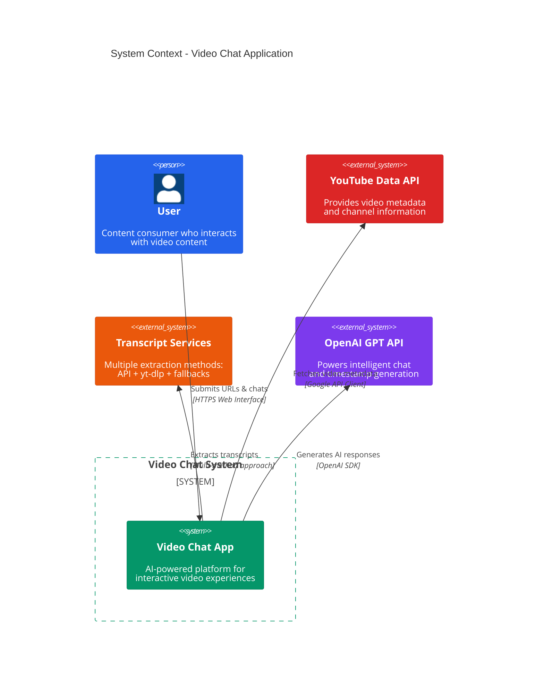

# System Context Diagram

## Overview
This diagram shows the high-level view of the Video Chat Application system and its interactions with external users and systems.

## Diagram

## Key External Dependencies

1. **YouTube Data API v3**: Essential for fetching video metadata, titles, and basic information via the Google API Python Client.
2. **YouTube Transcript Sources**: A multi-layered approach to transcript extraction using:
   - **youtube-transcript-api**: Primary method for transcript extraction
   - **yt-dlp**: Secondary method that downloads subtitles when primary method fails
   - **Manual extraction methods**: Additional fallback mechanisms for reliable transcript retrieval
3. **OpenAI API**: Core AI functionality for two main purposes:
   - Natural language chat responses based on video content
   - Intelligent timestamp generation for video navigation

## User Interactions

1. **Video Processing**:
   - User submits a YouTube URL through the frontend interface
   - System validates the URL and extracts the video ID
   - System fetches video metadata and transcript content
   - Frontend displays the embedded YouTube player with the processed video

2. **AI-Powered Video Chat**:
   - User enters questions or comments about the video content
   - System uses the video transcript as context for AI responses
   - User receives contextually relevant responses based on video content
   - Chat history is maintained throughout the session

3. **Content Search**:
   - User searches for specific topics within the video
   - System performs full-text search on the video transcript
   - Results are displayed with relevant timestamps
   - User can click results to navigate to specific video segments

4. **Timestamp Navigation**:
   - User requests timestamps for topics of interest
   - System generates intelligent timestamps based on content analysis
   - User navigates through the video using these timestamp links
   - Timestamp generation is context-aware based on video content

## Security Considerations

1. **API Security**:
   - All external API communications use HTTPS encryption
   - API keys are stored in environment variables using python-dotenv
   - YouTube API credentials managed through Google API Python Client
   - OpenAI API keys never exposed to the frontend

2. **Data Validation**:
   - FastAPI's Pydantic models enforce schema validation
   - Video URLs and IDs are sanitized before processing
   - Chat messages validated to prevent injection attacks
   - Search queries cleaned to prevent malicious inputs

3. **Request Management**:
   - CORS middleware restricts origins to the frontend domain
   - Rate limiting for external API calls to prevent quota exhaustion
   - Graceful error handling for failed external service requests
   - Multiple fallback methods for transcript extraction

4. **Development Security**:
   - Local PostgreSQL database with defined schemas
   - SQLAlchemy ORM with parameterized queries to prevent SQL injection
   - Alembic for database migration management
   - Detailed error logging without exposing sensitive information
