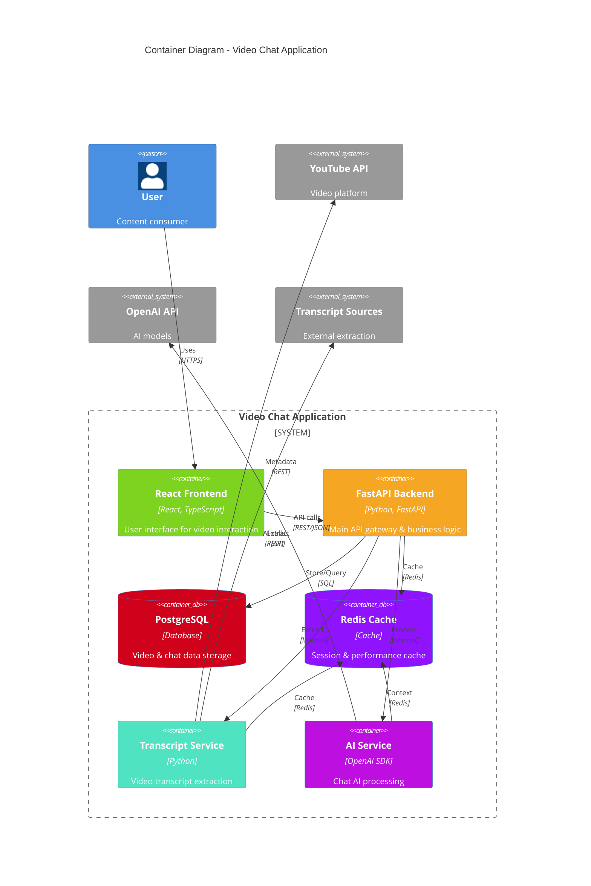

# Container Diagram

## Overview
This diagram shows the high-level containers (applications and data stores) that make up the Video Chat Application and how they interact.

## Diagram

## Container Responsibilities

### React Frontend
- **Technology**: React 18+, TypeScript, Vite build system
- **Purpose**: Single-page application providing the user interface
- **Key Features**:
  - Video player integration
  - Real-time chat interface
  - Search functionality
  - Timestamp navigation
  - Responsive design

### FastAPI Backend
- **Technology**: Python 3.11+, FastAPI, Uvicorn ASGI server
- **Purpose**: Main API gateway and business logic orchestrator
- **Key Features**:
  - RESTful API endpoints
  - Request validation and sanitization
  - Authentication and session management
  - CORS handling for frontend integration
  - Error handling and logging

### PostgreSQL Database
- **Technology**: PostgreSQL 15+ with asyncpg driver
- **Purpose**: Primary data persistence layer
- **Stored Data**:
  - Video metadata and transcripts
  - Chat conversation history
  - User session information
  - Timestamp mappings

### Redis Cache
- **Technology**: Redis 7+ with redis-py client
- **Purpose**: High-performance caching and session storage
- **Cached Data**:
  - Video transcripts (temporary)
  - Chat conversation context
  - API response caches
  - Rate limiting counters

### Transcript Service
- **Technology**: Python with multiple extraction libraries
- **Purpose**: Specialized video content extraction
- **Capabilities**:
  - Multiple fallback methods for transcript extraction
  - Content cleaning and formatting
  - Timestamp synchronization
  - Error handling for unavailable transcripts

### AI Chat Service
- **Technology**: Python with OpenAI SDK
- **Purpose**: AI-powered conversation management
- **Features**:
  - Context-aware chat responses
  - Video content analysis
  - Timestamp generation
  - Conversation memory management

## Key Architectural Decisions

1. **Microservice Architecture**: Services are logically separated for maintainability
2. **Async/Await Pattern**: Python async throughout for better performance
3. **Caching Strategy**: Redis for performance-critical data
4. **API-First Design**: Clear separation between frontend and backend
5. **External Service Integration**: Robust handling of third-party API dependencies
