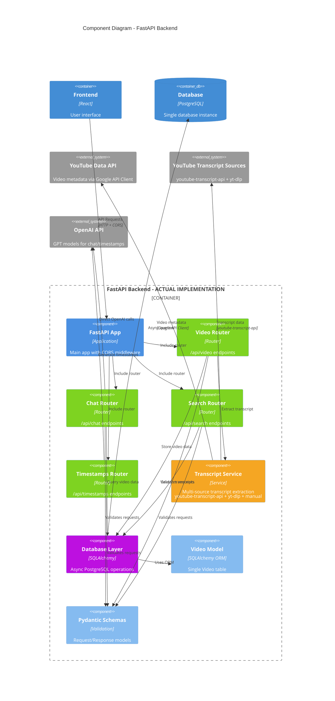

# Component Diagram - FastAPI Backend

## Overview
This diagram shows the internal components of the FastAPI Backend container and their interactions.

## Diagram

## Component Responsibilities

### API Layer

#### Main Application
- **File**: `main.py`
- **Purpose**: Application bootstrap and configuration
- **Features**:
  - CORS middleware configuration
  - Router registration
  - Database table creation
  - Application lifecycle management

#### Routers
- **Video Router** (`routers/video.py`):
  - `POST /api/video/process`: Process YouTube video URLs
  - Video ID extraction and validation
  - Transcript fetching coordination
  
- **Chat Router** (`routers/chat.py`):
  - `POST /api/chat/{session_id}`: Handle chat messages
  - Session management
  - AI response generation
  
- **Search Router** (`routers/search.py`):
  - `GET /api/search`: Search video content
  - Full-text search implementation
  - Result ranking and pagination
  
- **Timestamp Router** (`routers/timestamps.py`):
  - `POST /api/timestamps`: Generate timestamp links
  - Time-based content mapping
  - Video navigation helpers

### Business Logic Layer

#### Services
- **Video Service**: Coordinates video processing workflow
- **Chat Service**: Manages conversation state and AI interactions
- **Search Service**: Implements search algorithms and ranking
- **Transcript Service**: Handles multiple transcript extraction methods
- **OpenAI Service**: Manages AI API integration and response processing

### Data Layer

#### Database Service
- **Purpose**: Async database operations
- **Technology**: SQLAlchemy with asyncpg driver
- **Features**:
  - Connection pooling
  - Transaction management
  - Query optimization

#### Cache Service
- **Purpose**: Redis operations and caching strategies
- **Features**:
  - Session storage
  - Response caching
  - Rate limiting support

#### Models & Schemas
- **SQLAlchemy Models**: Database schema definitions
- **Pydantic Schemas**: API request/response validation
- **Data validation**: Type checking and serialization

### Cross-Cutting Concerns

#### Middleware
- **Custom Middleware**: Logging, error handling, request tracking
- **CORS Middleware**: Cross-origin request handling
- **Security Middleware**: Input validation and sanitization

## Key Architectural Patterns

1. **Router-Service Pattern**: Clear separation of API routing and business logic
2. **Dependency Injection**: FastAPI's built-in DI for database sessions
3. **Async/Await**: Non-blocking operations throughout the stack
4. **Repository Pattern**: Abstracted data access through services
5. **Schema Validation**: Pydantic models for request/response validation
