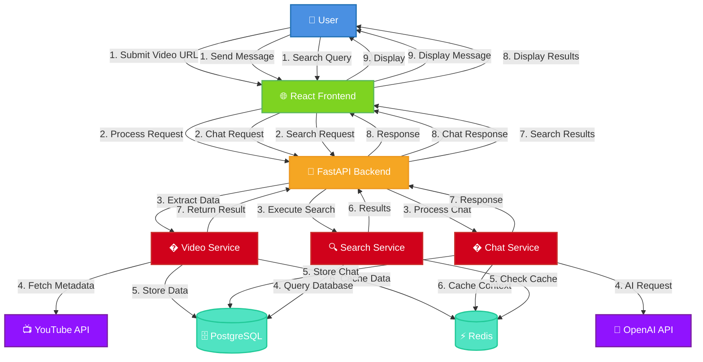

# Data Flow Diagram

## Overview
This diagram illustrates how data flows through the Video Chat Application system from user interactions to external services and back.

## Diagram



## Data Flow Scenarios

### 1. Video Processing Flow
```
User submits YouTube URL → Frontend validates → API call to backend → 
Extract video ID → Fetch metadata from YouTube API → 
Extract transcript → Store in database → Cache in Redis → 
Return processed video data → Update frontend state → Display to user
```

### 2. Chat Interaction Flow
```
User sends chat message → Frontend captures input → API call with session ID → 
Retrieve conversation context → Send to OpenAI API → 
Process AI response → Store in database → Cache context → 
Return response to frontend → Update chat interface → Display to user
```

### 3. Search Query Flow
```
User enters search query → Frontend validates → API call to backend → 
Query PostgreSQL for matching content → Apply ranking algorithms → 
Cache results in Redis → Return search results → 
Update frontend state → Display results to user
```

### 4. Timestamp Navigation Flow
```
User requests timestamps → Frontend processes request → API call to backend → 
Analyze video content → Generate time-based segments → 
Return timestamp data → Update video player → Enable navigation
```

## Data Types and Formats

### Input Data
- **YouTube URLs**: Various formats (watch, embed, short links)
- **Chat Messages**: Plain text with context
- **Search Queries**: Text with optional filters
- **Timestamp Requests**: Video segments and time ranges

### Processed Data
- **Video Metadata**: Title, duration, description, thumbnail
- **Transcripts**: Timestamped text content
- **Chat Context**: Conversation history and AI responses
- **Search Results**: Ranked content matches with snippets

### Cached Data
- **Video Transcripts**: Full text with timestamps (Redis)
- **Chat Sessions**: Conversation context and history (Redis)
- **Search Results**: Query results with TTL (Redis)
- **API Responses**: Frequently accessed data (Redis)

### Persistent Data
- **Video Records**: Metadata and transcripts (PostgreSQL)
- **Chat History**: Complete conversation logs (PostgreSQL)
- **User Sessions**: Session identifiers and state (PostgreSQL)
- **Application Logs**: Error tracking and analytics (PostgreSQL)

## Performance Optimizations

1. **Caching Strategy**: Multi-layer caching with Redis
2. **Async Operations**: Non-blocking I/O throughout the stack
3. **Connection Pooling**: Database connection management
4. **Response Compression**: Gzip compression for API responses
5. **Client-Side Caching**: Browser caching for static assets

## Error Handling

1. **Input Validation**: Client and server-side validation
2. **Graceful Degradation**: Fallback mechanisms for failed services
3. **Error Propagation**: Structured error responses
4. **Retry Logic**: Automatic retries for transient failures
5. **User Feedback**: Clear error messages and recovery guidance
