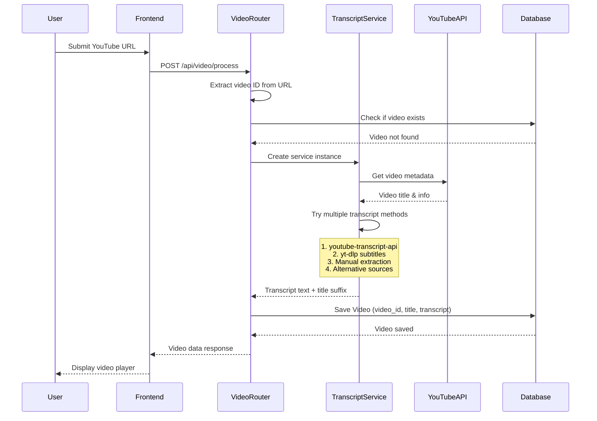
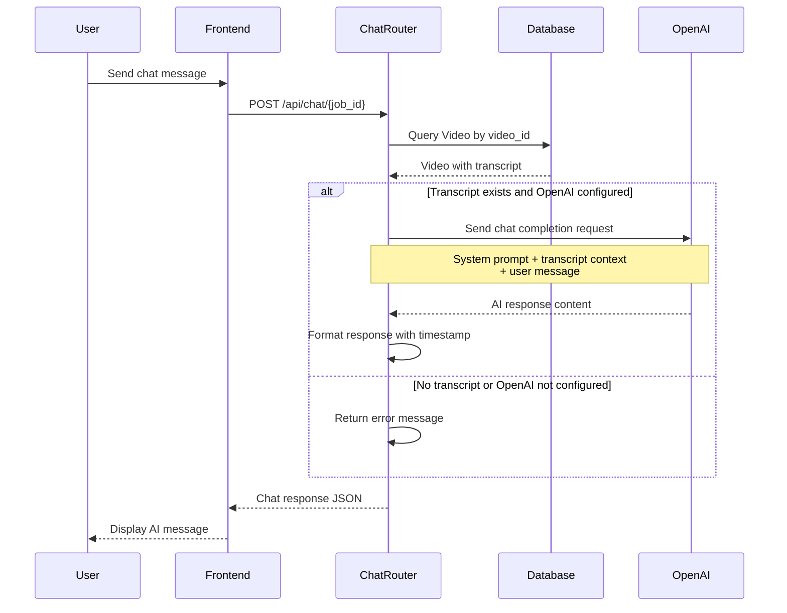
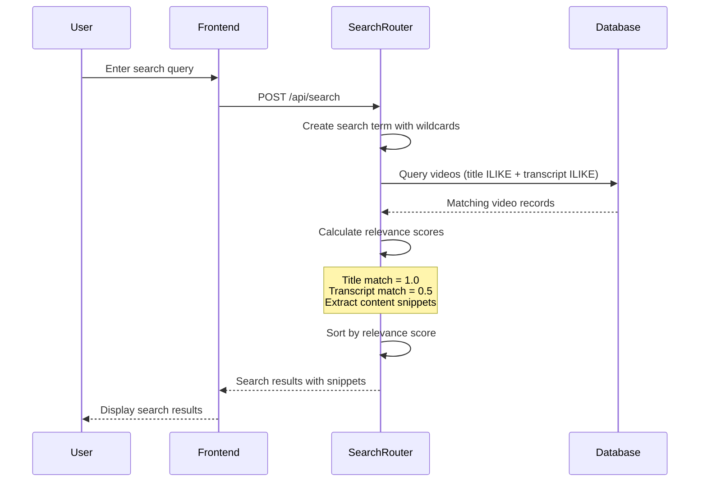
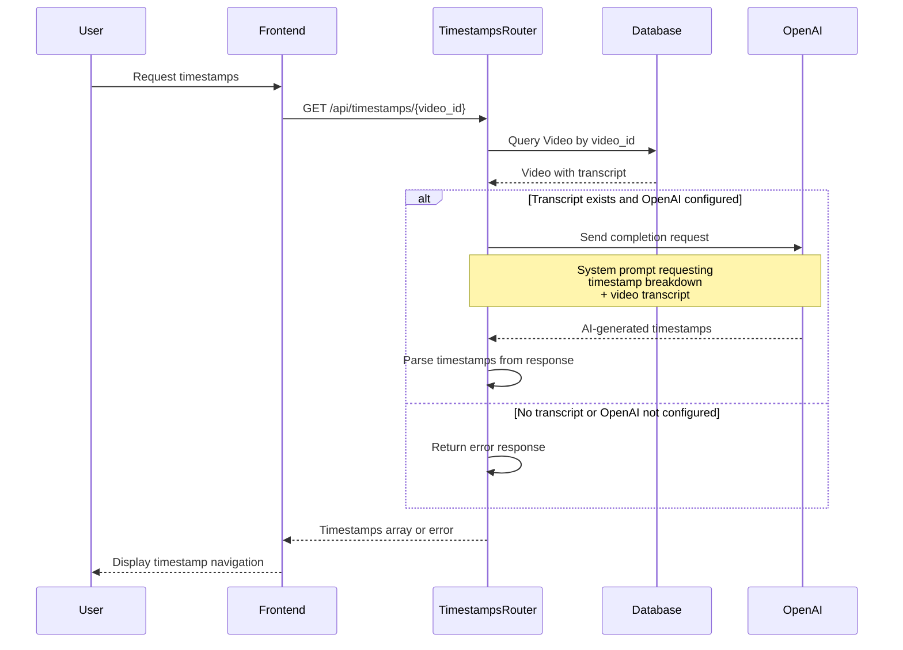
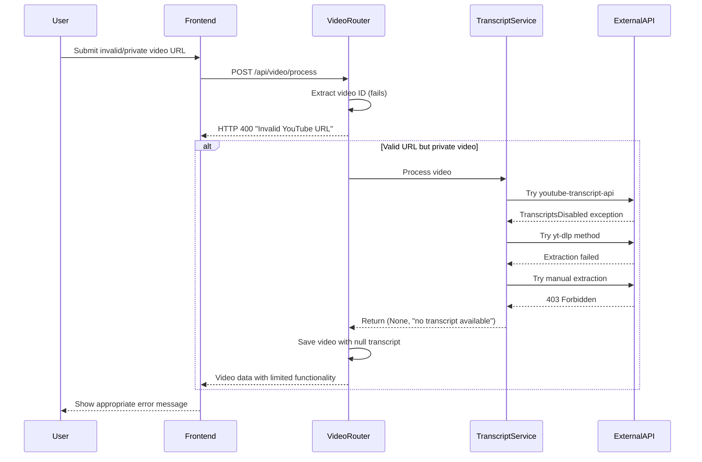

# Sequence Diagrams

## Overview
These diagrams show the detailed interactions between system components for key user scenarios.

## 1. Video Processing Sequence

## 2. Chat Interaction Sequence

## 3. Search Functionality Sequence

## 4. Timestamp Generation Sequence

## 5. Error Handling Sequence

## Key Interaction Patterns

### 1. Direct Router Pattern
- All business logic is handled directly in FastAPI routers
- No separate service layer - routers instantiate services as needed
- Direct database operations using SQLAlchemy async sessions

### 2. Error Handling Pattern
- HTTPException raised for client errors (400, 404)
- Graceful degradation when external services fail
- Multiple fallback methods for transcript extraction

### 3. External API Integration Pattern
- Direct async calls to OpenAI API using AsyncOpenAI client
- Multi-method transcript extraction with fallbacks
- Environment variable configuration for API keys

### 4. Database Pattern
- Simple async PostgreSQL operations
- Single Video model with video_id, title, transcript fields
- No caching layer - direct database queries

### 5. Stateless API Design
- Each request is independent
- Session ID used only for chat context identification
- No persistent session storage

## Performance Considerations

1. **Async Operations**: All database and external API calls are async
2. **Direct Integration**: No middleware or service abstraction overhead
3. **Simple Queries**: Basic ILIKE queries for search functionality
4. **Stateless Design**: No session management complexity
5. **Fallback Strategies**: Multiple methods for transcript extraction ensure reliability
