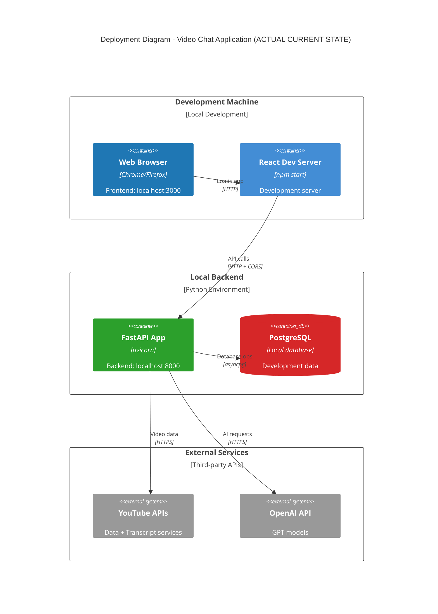

# Deployment Diagram

## Overview
This diagram shows how the Video Chat Application components are deployed across different environments and infrastructure.

## Diagram



## Deployment Environments

### Development Environment
- **Local Development**: Simple local setup (no Docker)
- **Database**: Local PostgreSQL instance
- **Frontend**: React development server (localhost:3000)
- **Backend**: FastAPI with Uvicorn (localhost:8000)
- **External APIs**: Production endpoints with API keys
- **Hot Reload**: Enabled for both frontend and backend

### Staging Environment
- **Infrastructure**: Smaller cloud instances (1-2 servers)
- **Database**: Managed PostgreSQL with automatic backups
- **Cache**: Managed Redis cluster
- **Monitoring**: Basic logging and metrics
- **Testing**: Automated test suite execution

### Production Environment
- **High Availability**: Multi-zone deployment with redundancy
- **Auto-scaling**: Horizontal scaling based on CPU/memory metrics
- **Load Balancing**: Application-level load balancing
- **Database**: Primary-replica setup with automatic failover
- **Monitoring**: Comprehensive observability stack

## Infrastructure Components

### Load Balancer Configuration
```yaml
# Application Load Balancer
Type: Application Load Balancer
Health Check: GET /health
Target Groups:
  - Frontend (Port 80/443)
  - Backend API (Port 8000)
SSL Termination: Yes
Sticky Sessions: No (stateless design)
```

### Auto-scaling Configuration
```yaml
# Auto Scaling Group
Min Instances: 2
Max Instances: 10
Target CPU: 70%
Scale Out: +2 instances when CPU > 70% for 5 minutes
Scale In: -1 instance when CPU < 30% for 10 minutes
Health Check Grace Period: 300 seconds
```

### Database Configuration
```yaml
# PostgreSQL Configuration
Instance Class: db.t3.large (4 vCPU, 16GB RAM)
Storage: 500GB GP2 SSD with auto-scaling
Backup Retention: 7 days
Multi-AZ: Yes (for high availability)
Read Replicas: 1 (for read scaling)
Connection Pooling: PgBouncer (max 100 connections)
```

### Cache Configuration
```yaml
# Redis Configuration
Node Type: cache.t3.medium (2 vCPU, 4GB RAM)
Cluster Mode: Yes (3 shards, 1 replica each)
Backup: Daily snapshots
Eviction Policy: allkeys-lru
TTL: Configurable per key type
```

## Security Considerations

### Network Security
- **VPC**: Private subnets for databases and application servers
- **Security Groups**: Restrictive firewall rules
- **WAF**: Web Application Firewall for DDoS protection
- **SSL/TLS**: End-to-end encryption for all communications

### Access Control
- **IAM**: Role-based access control for cloud resources
- **API Keys**: Secure storage in environment variables
- **Database**: Encrypted at rest and in transit
- **Secrets Management**: Dedicated secrets management service

### Monitoring & Compliance
- **Audit Logs**: Comprehensive logging of all API calls
- **Intrusion Detection**: Monitoring for suspicious activities
- **Vulnerability Scanning**: Regular security assessments
- **Compliance**: GDPR/CCPA data protection measures

## Disaster Recovery

### Backup Strategy
- **Database**: Automated daily backups with 7-day retention
- **Application Code**: Version control with Git
- **Configuration**: Infrastructure as Code (Terraform/CloudFormation)
- **Media Assets**: CDN with multiple edge locations

### Recovery Procedures
- **RTO (Recovery Time Objective)**: 4 hours
- **RPO (Recovery Point Objective)**: 1 hour
- **Failover**: Automated database failover to replica
- **Rollback**: Blue-green deployment for safe rollbacks

## Performance Targets

### Response Times
- **Frontend Load**: < 2 seconds
- **API Responses**: < 500ms (95th percentile)
- **Database Queries**: < 100ms (average)
- **External API Calls**: < 2 seconds (with retries)

### Throughput
- **Concurrent Users**: 1,000+ simultaneous sessions
- **API Requests**: 10,000+ requests per minute
- **Database Connections**: 100 concurrent connections
- **Cache Hit Rate**: > 80% for frequently accessed data

### Availability
- **Uptime Target**: 99.9% (8.76 hours downtime per year)
- **Monitoring**: Real-time health checks every 30 seconds
- **Alerting**: Immediate notifications for service degradation
- **Maintenance Windows**: Scheduled during low-traffic periods
