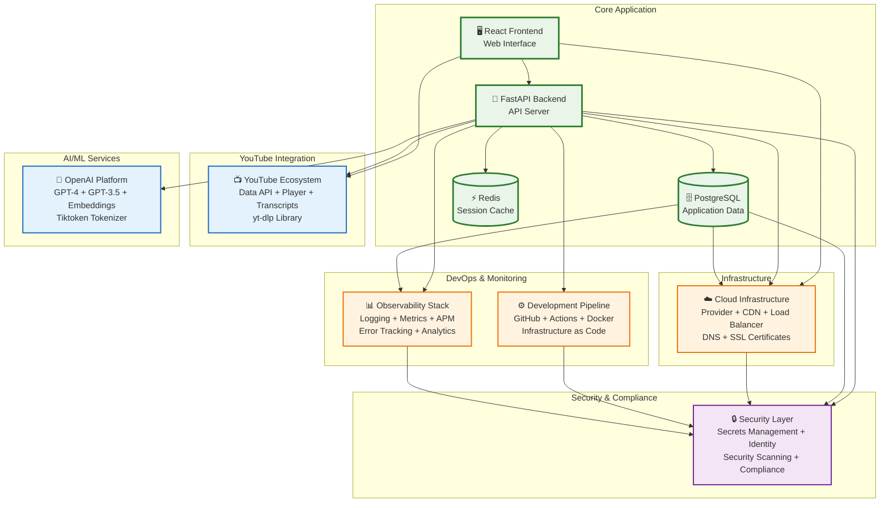

# Integration Architecture Diagram

## Overview
This diagram shows how the Video Chat Application integrates with external services, APIs, and third-party systems.

## Diagram


    Backend --> LoadBalancer
    LoadBalancer --> CloudProvider
    CloudProvider --> DNS
    CloudProvider --> SSL

    %% Data persistence
    Backend --> Database
    Backend --> Cache

    %% Monitoring integrations
    Backend --> LoggingService
    Backend --> MetricsService
    Backend --> APMService
    Backend --> ErrorTracking
    Frontend --> Analytics

    %% Development workflow
    GitHub --> GitHubActions
    GitHubActions --> DockerHub
    GitHubActions --> CloudProvider
    Terraform --> CloudProvider

    %% Security integrations
    Backend --> SecretsManager
    Backend --> IdentityProvider
    GitHubActions --> SecurityScanning
    CloudProvider --> ComplianceTools

    %% Styling
    classDef app fill:#e3f2fd,stroke:#1976d2,stroke-width:3px
    classDef youtube fill:#ff4444,stroke:#cc0000,stroke-width:2px
    classDef ai fill:#4caf50,stroke:#2e7d32,stroke-width:2px
    classDef infra fill:#ff9800,stroke:#e65100,stroke-width:2px
    classDef monitoring fill:#9c27b0,stroke:#6a1b9a,stroke-width:2px
    classDef devops fill:#607d8b,stroke:#37474f,stroke-width:2px
    classDef security fill:#795548,stroke:#5d4037,stroke-width:2px

    class Frontend,Backend,Database,Cache app
    class YouTubeAPI,YouTubePlayer,YouTubeTranscript,YouTubeDL youtube
    class OpenAIAPI,GPT4,GPT35,EmbeddingAPI,Tokenizer ai
    class CloudProvider,CDN,LoadBalancer,DNS,SSL infra
    class LoggingService,MetricsService,APMService,ErrorTracking,Analytics monitoring
    class GitHub,GitHubActions,DockerHub,Terraform devops
    class SecretsManager,IdentityProvider,SecurityScanning,ComplianceTools security
```

## Integration Details

### 1. YouTube Ecosystem Integration

#### YouTube Data API v3
```python
# YouTube API integration
from googleapiclient.discovery import build
from googleapiclient.errors import HttpError

class YouTubeAPIClient:
    def __init__(self, api_key: str):
        self.youtube = build('youtube', 'v3', developerKey=api_key)
        self.quota_manager = QuotaManager(daily_limit=10000)
    
    async def get_video_details(self, video_id: str) -> dict:
        try:
            if not await self.quota_manager.can_make_request(cost=1):
                raise QuotaExceededError("Daily quota exceeded")
            
            request = self.youtube.videos().list(
                part="snippet,contentDetails,statistics",
                id=video_id
            )
            
            response = request.execute()
            await self.quota_manager.record_request(cost=1)
            
            if not response['items']:
                raise VideoNotFoundError(f"Video {video_id} not found")
            
            return self._transform_video_data(response['items'][0])
            
        except HttpError as e:
            if e.resp.status == 403:
                await self._handle_quota_exceeded()
            raise YouTubeAPIError(f"API request failed: {e}")
```

#### YouTube Player API Integration
```typescript
// YouTube Player integration in React
interface YouTubePlayerProps {
    videoId: string;
    onTimeUpdate: (currentTime: number) => void;
    onPlayerReady: () => void;
}

const YouTubePlayer: React.FC<YouTubePlayerProps> = ({ 
    videoId, 
    onTimeUpdate, 
    onPlayerReady 
}) => {
    const playerRef = useRef<YT.Player | null>(null);

    useEffect(() => {
        // Load YouTube IFrame API
        if (!window.YT) {
            const script = document.createElement('script');
            script.src = 'https://www.youtube.com/iframe_api';
            document.body.appendChild(script);
            
            window.onYouTubeIframeAPIReady = initializePlayer;
        } else {
            initializePlayer();
        }
    }, [videoId]);

    const initializePlayer = () => {
        playerRef.current = new window.YT.Player('youtube-player', {
            videoId: videoId,
            playerVars: {
                autoplay: 0,
                controls: 1,
                enablejsapi: 1,
                origin: window.location.origin
            },
            events: {
                onReady: onPlayerReady,
                onStateChange: handleStateChange
            }
        });

        // Time update polling
        const interval = setInterval(() => {
            if (playerRef.current && playerRef.current.getCurrentTime) {
                onTimeUpdate(playerRef.current.getCurrentTime());
            }
        }, 1000);

        return () => clearInterval(interval);
    };
};
```

#### Transcript Extraction with Fallbacks
```python
# Multi-method transcript extraction
class TranscriptExtractor:
    def __init__(self):
        self.methods = [
            self._extract_with_youtube_transcript_api,
            self._extract_with_ytdlp,
            self._extract_with_manual_captions,
            self._extract_with_auto_generated
        ]
    
    async def extract_transcript(self, video_id: str) -> TranscriptResult:
        for i, method in enumerate(self.methods):
            try:
                logger.info(f"Trying method {i+1}: {method.__name__}")
                result = await method(video_id)
                
                if result.success:
                    logger.info(f"Successfully extracted transcript using {method.__name__}")
                    return result
                    
            except Exception as e:
                logger.warning(f"Method {method.__name__} failed: {str(e)}")
                continue
        
        # All methods failed
        return TranscriptResult(
            success=False,
            error="No transcript available for this video",
            fallback_message="Try a video with captions enabled"
        )
    
    async def _extract_with_youtube_transcript_api(self, video_id: str):
        transcript_list = YouTubeTranscriptApi.get_transcript(
            video_id, 
            languages=['en', 'en-US', 'en-GB']
        )
        
        formatted_transcript = self._format_transcript(transcript_list)
        return TranscriptResult(success=True, content=formatted_transcript)
```

### 2. OpenAI Integration

#### GPT-4 Chat Integration
```python
# OpenAI client with retry logic and error handling
from openai import AsyncOpenAI
import tiktoken

class OpenAIService:
    def __init__(self):
        self.client = AsyncOpenAI(api_key=os.getenv("OPENAI_API_KEY"))
        self.encoder = tiktoken.encoding_for_model("gpt-4")
        self.max_tokens = 8192
        self.retry_config = ExponentialBackoff(
            initial_delay=1,
            max_delay=60,
            max_retries=3
        )
    
    async def generate_chat_response(
        self, 
        messages: List[dict], 
        video_context: str,
        model: str = "gpt-4"
    ) -> ChatResponse:
        
        # Build context-aware prompt
        system_prompt = self._build_system_prompt(video_context)
        full_messages = [{"role": "system", "content": system_prompt}] + messages
        
        # Token management
        if self._count_tokens(full_messages) > self.max_tokens:
            full_messages = self._truncate_messages(full_messages)
        
        try:
            response = await self._make_request_with_retry(
                model=model,
                messages=full_messages,
                temperature=0.7,
                max_tokens=1000
            )
            
            return ChatResponse(
                content=response.choices[0].message.content,
                tokens_used=response.usage.total_tokens,
                model_used=model,
                timestamp=datetime.utcnow()
            )
            
        except OpenAIError as e:
            logger.error(f"OpenAI API error: {str(e)}")
            return await self._handle_openai_error(e, messages, video_context)
    
    def _build_system_prompt(self, video_context: str) -> str:
        return f"""
        You are an AI assistant helping users understand and discuss a YouTube video.
        
        Video Context:
        {video_context}
        
        Instructions:
        - Answer questions based on the video content
        - Provide timestamps when referencing specific parts
        - Be helpful, accurate, and conversational
        - If asked about content not in the video, politely clarify
        """
    
    async def _make_request_with_retry(self, **kwargs):
        return await self.retry_config.execute(
            lambda: self.client.chat.completions.create(**kwargs)
        )
```

#### Embedding Service for Semantic Search
```python
# Text embedding for semantic search
class EmbeddingService:
    def __init__(self):
        self.client = AsyncOpenAI()
        self.model = "text-embedding-ada-002"
        self.cache = EmbeddingCache()
    
    async def get_embeddings(self, texts: List[str]) -> List[List[float]]:
        # Check cache first
        cached_embeddings = await self.cache.get_batch(texts)
        uncached_texts = [text for text, embedding in zip(texts, cached_embeddings) if embedding is None]
        
        if uncached_texts:
            # Generate embeddings for uncached texts
            response = await self.client.embeddings.create(
                model=self.model,
                input=uncached_texts
            )
            
            new_embeddings = [data.embedding for data in response.data]
            
            # Cache new embeddings
            await self.cache.set_batch(
                list(zip(uncached_texts, new_embeddings))
            )
            
            # Merge cached and new embeddings
            result = []
            uncached_iter = iter(new_embeddings)
            
            for cached_embedding in cached_embeddings:
                if cached_embedding is None:
                    result.append(next(uncached_iter))
                else:
                    result.append(cached_embedding)
            
            return result
        
        return cached_embeddings
```

### 3. Infrastructure Integrations

#### Cloud Provider Integration (AWS Example)
```python
# AWS services integration
import boto3
from botocore.exceptions import ClientError

class AWSIntegration:
    def __init__(self):
        self.session = boto3.Session()
        self.s3 = self.session.client('s3')
        self.secrets_manager = self.session.client('secretsmanager')
        self.cloudwatch = self.session.client('cloudwatch')
    
    async def store_video_data(self, video_id: str, data: dict):
        """Store processed video data in S3"""
        try:
            self.s3.put_object(
                Bucket=os.getenv('VIDEO_DATA_BUCKET'),
                Key=f'videos/{video_id}/metadata.json',
                Body=json.dumps(data),
                ContentType='application/json',
                ServerSideEncryption='AES256'
            )
        except ClientError as e:
            logger.error(f"Failed to store video data: {e}")
            raise StorageError("Failed to store video data")
    
    async def get_secret(self, secret_name: str) -> str:
        """Retrieve secrets from AWS Secrets Manager"""
        try:
            response = self.secrets_manager.get_secret_value(
                SecretId=secret_name
            )
            return response['SecretString']
        except ClientError as e:
            logger.error(f"Failed to retrieve secret {secret_name}: {e}")
            raise SecretRetrievalError(f"Cannot access secret: {secret_name}")
    
    async def publish_metrics(self, metrics: List[dict]):
        """Publish custom metrics to CloudWatch"""
        try:
            self.cloudwatch.put_metric_data(
                Namespace='VideoChat/Application',
                MetricData=metrics
            )
        except ClientError as e:
            logger.error(f"Failed to publish metrics: {e}")
```

#### CDN Integration
```typescript
// CDN and asset optimization
export class CDNManager {
    private cdnBaseUrl: string;
    private assetVersion: string;

    constructor() {
        this.cdnBaseUrl = process.env.REACT_APP_CDN_URL || '';
        this.assetVersion = process.env.REACT_APP_VERSION || 'latest';
    }

    getAssetUrl(path: string): string {
        // Add cache busting and optimization parameters
        const optimizedPath = this.addOptimizations(path);
        return `${this.cdnBaseUrl}/${this.assetVersion}${optimizedPath}`;
    }

    private addOptimizations(path: string): string {
        if (path.match(/\.(jpg|jpeg|png|gif)$/i)) {
            // Add image optimization parameters
            return `${path}?format=webp&quality=85&w=800`;
        }
        
        if (path.match(/\.(js|css)$/i)) {
            // Add compression indicators
            return `${path}?compress=gzip`;
        }
        
        return path;
    }

    preloadCriticalAssets(): void {
        const criticalAssets = [
            '/static/css/app.css',
            '/static/js/app.js',
            '/static/images/logo.svg'
        ];

        criticalAssets.forEach(asset => {
            const link = document.createElement('link');
            link.rel = 'preload';
            link.href = this.getAssetUrl(asset);
            link.as = this.getAssetType(asset);
            document.head.appendChild(link);
        });
    }
}
```

### 4. Monitoring and Analytics Integration

#### Application Performance Monitoring
```python
# APM integration (example with DataDog)
from ddtrace import tracer, patch_all
import logging

# Auto-instrument common libraries
patch_all()

class APMIntegration:
    def __init__(self):
        self.tracer = tracer
        self.logger = logging.getLogger(__name__)
    
    def trace_video_processing(self, func):
        """Decorator for tracing video processing operations"""
        @self.tracer.wrap('video.processing', service='video-chat-app')
        def wrapper(*args, **kwargs):
            span = self.tracer.current_span()
            if span:
                span.set_tag('video.id', kwargs.get('video_id'))
                span.set_tag('operation.type', 'transcript_extraction')
            
            try:
                result = func(*args, **kwargs)
                if span:
                    span.set_tag('operation.success', True)
                return result
            except Exception as e:
                if span:
                    span.set_tag('operation.success', False)
                    span.set_tag('error.message', str(e))
                raise
        
        return wrapper
    
    async def log_user_interaction(self, user_id: str, action: str, metadata: dict):
        """Log user interactions for analytics"""
        event_data = {
            'user_id': user_id,
            'action': action,
            'timestamp': datetime.utcnow().isoformat(),
            'metadata': metadata,
            'session_id': self.get_current_session_id()
        }
        
        # Send to analytics service
        await self.send_to_analytics(event_data)
        
        # Log for debugging
        self.logger.info(f"User interaction: {action}", extra=event_data)
```

#### Error Tracking Integration
```python
# Error tracking with Sentry
import sentry_sdk
from sentry_sdk.integrations.fastapi import FastApiIntegration
from sentry_sdk.integrations.sqlalchemy import SqlalchemyIntegration

class ErrorTrackingIntegration:
    def __init__(self):
        sentry_sdk.init(
            dsn=os.getenv("SENTRY_DSN"),
            integrations=[
                FastApiIntegration(auto_enabling=True),
                SqlalchemyIntegration(),
            ],
            traces_sample_rate=0.1,  # 10% of transactions
            release=os.getenv("APP_VERSION"),
            environment=os.getenv("ENVIRONMENT", "development")
        )
    
    @staticmethod
    def capture_video_processing_error(video_id: str, error: Exception):
        with sentry_sdk.configure_scope() as scope:
            scope.set_tag("error_type", "video_processing")
            scope.set_context("video", {"video_id": video_id})
            scope.set_level("error")
            
            sentry_sdk.capture_exception(error)
    
    @staticmethod
    def capture_api_error(endpoint: str, user_id: str, error: Exception):
        with sentry_sdk.configure_scope() as scope:
            scope.set_tag("error_type", "api_error")
            scope.set_tag("endpoint", endpoint)
            scope.set_user({"id": user_id})
            
            sentry_sdk.capture_exception(error)
```

### 5. CI/CD Integration

#### GitHub Actions Workflow
```yaml
# .github/workflows/deploy.yml
name: Deploy to Production

on:
  push:
    branches: [main]
  pull_request:
    branches: [main]

jobs:
  test:
    runs-on: ubuntu-latest
    
    services:
      postgres:
        image: postgres:15
        env:
          POSTGRES_PASSWORD: test
        options: >-
          --health-cmd pg_isready
          --health-interval 10s
          --health-timeout 5s
          --health-retries 5
      
      redis:
        image: redis:7
        options: >-
          --health-cmd "redis-cli ping"
          --health-interval 10s
          --health-timeout 5s
          --health-retries 5

    steps:
    - uses: actions/checkout@v3
    
    - name: Set up Python
      uses: actions/setup-python@v4
      with:
        python-version: '3.11'
    
    - name: Install dependencies
      run: |
        pip install -r backend/requirements.txt
        pip install pytest pytest-asyncio pytest-cov
    
    - name: Run tests
      run: |
        cd backend
        pytest --cov=. --cov-report=xml
    
    - name: Security scan
      uses: securecodewarrior/github-action-add-sarif@v1
      with:
        sarif-file: security-scan-results.sarif

  deploy:
    needs: test
    runs-on: ubuntu-latest
    if: github.ref == 'refs/heads/main'
    
    steps:
    - name: Deploy to production
      run: |
        # Deployment script
        ./scripts/deploy.sh production
```

## Integration Best Practices

### 1. Error Handling and Resilience
- **Circuit Breaker Pattern**: Prevent cascading failures
- **Retry Logic**: Exponential backoff for transient failures  
- **Graceful Degradation**: Continue operation with reduced functionality
- **Timeout Management**: Prevent hanging requests

### 2. Rate Limiting and Quotas
- **API Rate Limits**: Respect external service limits
- **Quota Management**: Track and manage API usage
- **Cost Optimization**: Minimize expensive API calls
- **Fallback Strategies**: Alternative approaches when limits are reached

### 3. Security and Compliance
- **API Key Rotation**: Regular key updates
- **Secure Communications**: TLS/SSL for all integrations
- **Access Control**: Principle of least privilege
- **Audit Logging**: Track all external interactions

### 4. Monitoring and Alerting
- **Health Checks**: Monitor external service availability
- **Performance Metrics**: Track integration response times
- **Error Rates**: Monitor and alert on integration failures
- **Dependency Mapping**: Understand service relationships
