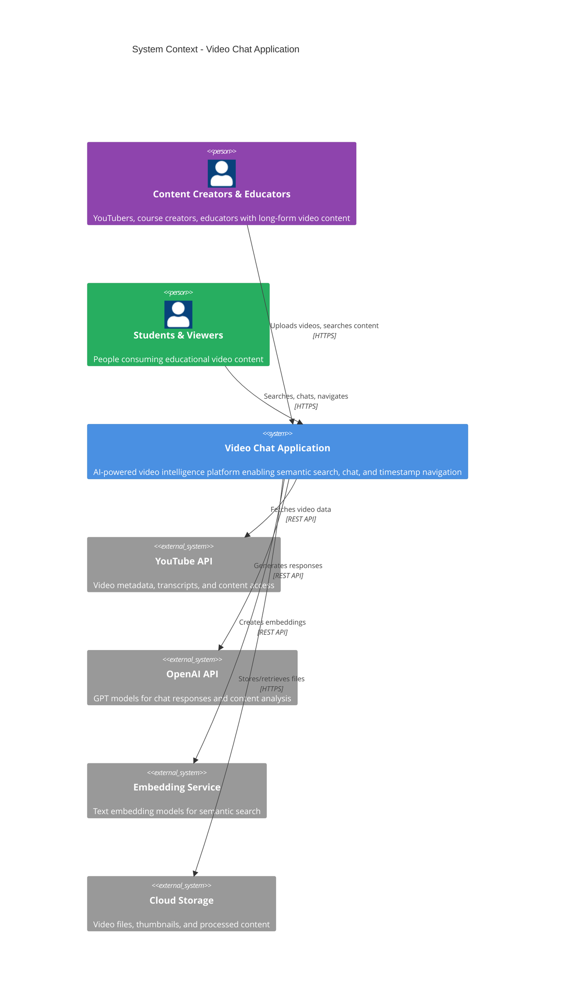
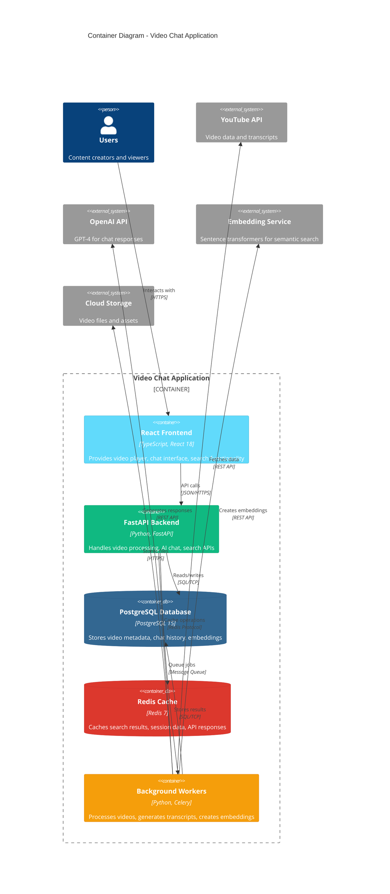
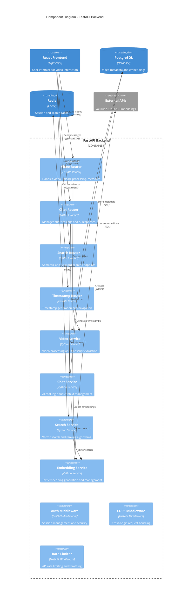
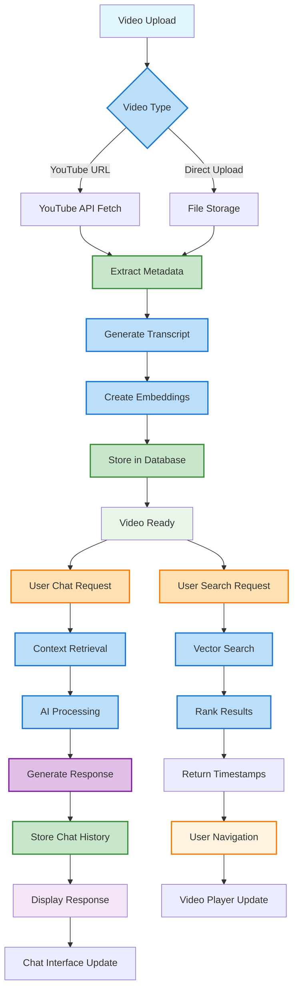
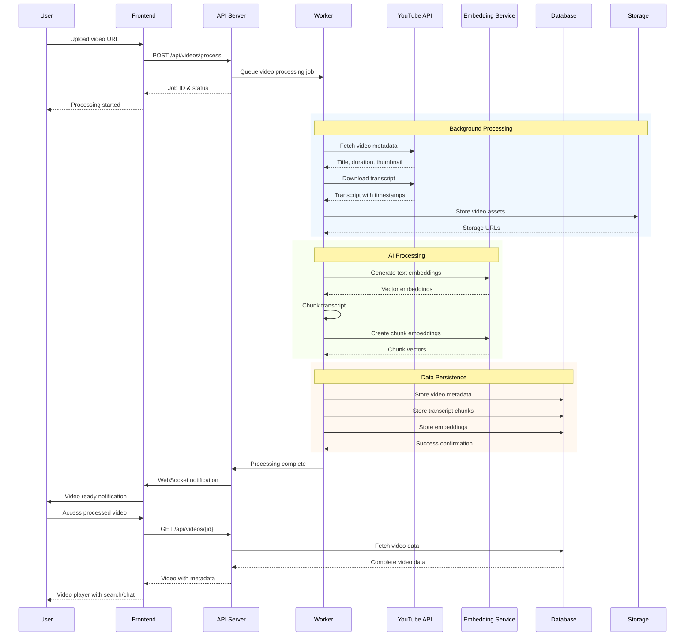
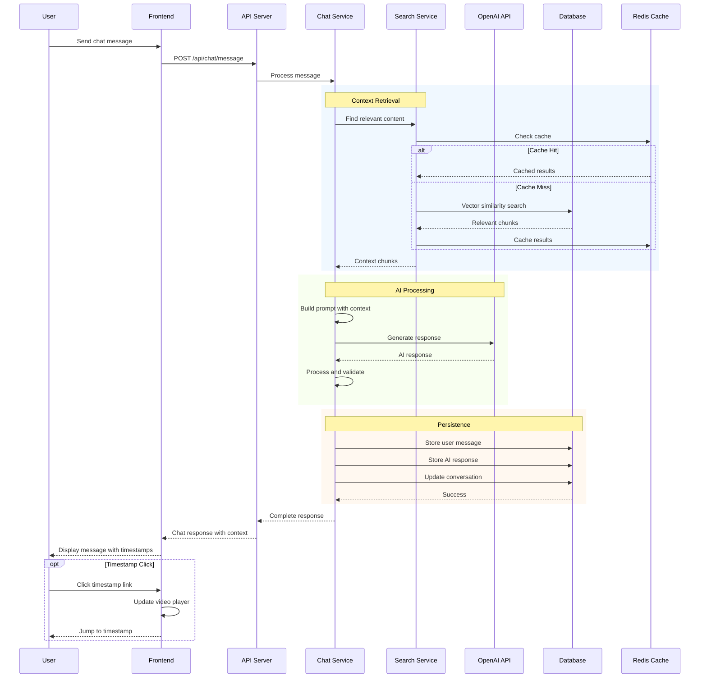
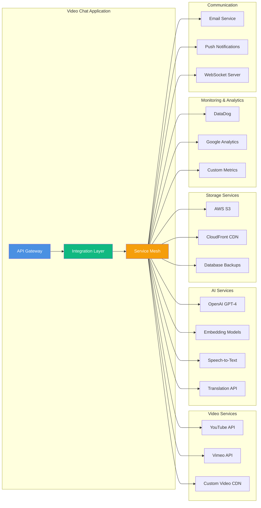

# Video Chat Application - Comprehensive Architectural Diagrams

## Overview

This document presents a comprehensive set of architectural diagrams for the Video Chat Application, following standardized notations and best practices. The diagrams are designed to serve both technical and non-technical stakeholders, highlighting system components, data flow, integration points, and key technologies while emphasizing scalability, security, and performance considerations.

## Table of Contents

- [Video Chat Application - Comprehensive Architectural Diagrams](#video-chat-application---comprehensive-architectural-diagrams)
  - [Overview](#overview)
  - [Table of Contents](#table-of-contents)
  - [1. C4 System Context Diagram](#1-c4-system-context-diagram)
  - [2. C4 Container Diagram](#2-c4-container-diagram)
  - [3. C4 Component Diagram](#3-c4-component-diagram)
  - [4. Data Flow Architecture](#4-data-flow-architecture)
  - [5. Sequence Diagram - Video Processing Flow](#5-sequence-diagram---video-processing-flow)
  - [6. Sequence Diagram - Chat Interaction Flow](#6-sequence-diagram---chat-interaction-flow)
  - [7. Deployment Architecture](#7-deployment-architecture)
  - [8. Security Architecture](#8-security-architecture)
  - [9. Performance \& Scalability Architecture](#9-performance--scalability-architecture)
  - [10. Integration Architecture](#10-integration-architecture)
  - [Architecture Summary](#architecture-summary)
    - [Key Technologies Used](#key-technologies-used)
    - [Scalability Considerations](#scalability-considerations)
    - [Security Measures](#security-measures)
    - [Performance Optimizations](#performance-optimizations)

---

## 1. C4 System Context Diagram

**Purpose**: High-level view showing how the Video Chat Application fits into the broader ecosystem and its external dependencies.



**Key Insights**:
- **External Dependencies**: YouTube API, OpenAI API, Embedding services
- **User Types**: Content creators (upload) vs. consumers (search/chat)
- **Primary Interactions**: Video processing, semantic search, AI chat

---

## 2. C4 Container Diagram

**Purpose**: Shows the high-level shape of the software architecture and how responsibilities are distributed across containers.



**Technology Decisions**:
- **Frontend**: React 18 with TypeScript for type safety and modern features
- **Backend**: FastAPI for high-performance async APIs with automatic OpenAPI docs
- **Database**: PostgreSQL for ACID compliance and vector extension support
- **Cache**: Redis for fast session and search result caching
- **Workers**: Celery for reliable background task processing

---

## 3. C4 Component Diagram

**Purpose**: Detailed view of the FastAPI backend components and their interactions.



**Component Responsibilities**:
- **Routers**: Handle HTTP requests, validation, and responses
- **Services**: Implement business logic and data processing
- **Middleware**: Cross-cutting concerns (auth, CORS, rate limiting)

---

## 4. Data Flow Architecture

**Purpose**: Shows how data flows through the system from video upload to user interaction.



**Data Flow Insights**:
- **Video Processing**: Asynchronous pipeline from upload to searchable content
- **Search Path**: Vector similarity search with ranking algorithms
- **Chat Path**: Context-aware AI responses with conversation history
- **Real-time Updates**: WebSocket connections for live chat and navigation

---

## 5. Sequence Diagram - Video Processing Flow

**Purpose**: Detailed interaction flow for video processing from upload to completion.



**Performance Considerations**:
- **Async Processing**: Non-blocking video processing with job queues
- **Chunking Strategy**: Optimal transcript segmentation for embeddings
- **Batch Operations**: Efficient bulk database operations
- **Caching**: Metadata and embeddings cached for fast retrieval

---

## 6. Sequence Diagram - Chat Interaction Flow

**Purpose**: Shows the AI chat interaction flow with context-aware responses.



**AI Features**:
- **Context-Aware**: Uses relevant video content for responses
- **Conversation Memory**: Maintains chat history for coherent discussions
- **Timestamp Integration**: Automatically links responses to video moments
- **Performance**: Cached context retrieval for fast responses

---

## 7. Deployment Architecture

**Purpose**: Production deployment infrastructure with scalability and reliability considerations.

```mermaid
C4Deployment
    title Production Deployment - Video Chat Application
    
    Deployment_Node(cdn, "CDN", "CloudFlare") {
        Container(static, "Static Assets", "React Build", "Optimized frontend bundle")
    }
    
    Deployment_Node(lb, "Load Balancer", "AWS ALB") {
        Container(alb, "Application Load Balancer", "AWS ALB", "SSL termination, routing")
    }
    
    Deployment_Node(web, "Web Tier", "ECS Fargate") {
        Deployment_Node(api_cluster, "API Cluster", "Auto Scaling Group") {
            Container(api1, "FastAPI Instance 1", "Docker Container", "API server instance")
            Container(api2, "FastAPI Instance 2", "Docker Container", "API server instance")
            Container(api3, "FastAPI Instance N", "Docker Container", "Auto-scaled instances")
        }
    }
    
    Deployment_Node(worker_tier, "Worker Tier", "ECS Fargate") {
        Container(worker1, "Video Processor", "Celery Worker", "Video processing tasks")
        Container(worker2, "AI Worker", "Celery Worker", "AI and embedding tasks")
        Container(queue, "Message Queue", "Redis/SQS", "Task distribution")
    }
    
    Deployment_Node(data, "Data Tier", "AWS RDS + ElastiCache") {
        ContainerDb(postgres, "PostgreSQL", "AWS RDS Multi-AZ", "Primary database with failover")
        ContainerDb(redis, "Redis Cluster", "AWS ElastiCache", "Distributed cache")
        ContainerDb(s3, "Object Storage", "AWS S3", "Video files and assets")
    }
    
    Deployment_Node(monitor, "Monitoring", "AWS CloudWatch + DataDog") {
        Container(logs, "Log Aggregation", "CloudWatch Logs", "Centralized logging")
        Container(metrics, "Metrics", "DataDog", "Performance monitoring")
        Container(alerts, "Alerting", "PagerDuty", "Incident management")
    }
    
    Rel(cdn, lb, "Routes requests", "HTTPS")
    Rel(lb, api_cluster, "Load balances", "HTTPS")
    Rel(api_cluster, postgres, "Database queries", "PostgreSQL")
    Rel(api_cluster, redis, "Cache operations", "Redis")
    Rel(api_cluster, queue, "Queue tasks", "Redis/SQS")
    Rel(worker_tier, queue, "Process tasks", "Redis/SQS")
    Rel(worker_tier, postgres, "Store results", "PostgreSQL")
    Rel(worker_tier, s3, "Store files", "S3 API")
    
    UpdateElementStyle(cdn, $bgColor="#ff9500")
    UpdateElementStyle(lb, $bgColor="#232f3e")
    UpdateElementStyle(api_cluster, $bgColor="#4a90e2")
    UpdateElementStyle(worker_tier, $bgColor="#f59e0b")
    UpdateElementStyle(data, $bgColor="#10b981")
```

**Infrastructure Highlights**:
- **High Availability**: Multi-AZ deployment with auto-scaling
- **Performance**: CDN for static assets, Redis caching
- **Scalability**: Horizontal scaling for API and workers
- **Monitoring**: Comprehensive observability stack

---

## 8. Security Architecture

**Purpose**: Security layers and measures implemented across the system.

```mermaid
flowchart TB
    subgraph "External Layer"
        A[WAF/DDoS Protection] --> B[Rate Limiting]
        B --> C[SSL/TLS Termination]
    end
    
    subgraph "API Gateway Layer"
        C --> D[Authentication Middleware]
        D --> E[Authorization Checks]
        E --> F[Input Validation]
        F --> G[Request Sanitization]
    end
    
    subgraph "Application Layer"
        G --> H[JWT Token Validation]
        H --> I[Role-Based Access Control]
        I --> J[API Key Management]
        J --> K[Data Encryption at Rest]
    end
    
    subgraph "Database Layer"
        K --> L[SQL Injection Prevention]
        L --> M[Database Encryption]
        M --> N[Access Control Lists]
        N --> O[Audit Logging]
    end
    
    subgraph "Infrastructure Layer"
        O --> P[VPC Isolation]
        P --> Q[Security Groups]
        Q --> R[IAM Roles & Policies]
        R --> S[Secrets Management]
    end
    
    subgraph "Monitoring Layer"
        S --> T[Security Event Logging]
        T --> U[Anomaly Detection]
        U --> V[Incident Response]
        V --> W[Compliance Monitoring]
    end
    
    style A fill:#ff6b6b,color:white
    style D fill:#4ecdc4,color:white
    style H fill:#45b7d1,color:white
    style L fill:#96ceb4,color:white
    style P fill:#feca57,color:white
    style T fill:#ff9ff3,color:white
```



**Security Measures**:
- **External Protection**: WAF, DDoS protection, rate limiting
- **Authentication**: JWT tokens with refresh mechanism
- **Authorization**: Role-based access control (RBAC)
- **Data Protection**: Encryption at rest and in transit
- **Infrastructure**: VPC isolation, security groups, IAM
- **Monitoring**: Security event logging and anomaly detection

---

## 9. Performance & Scalability Architecture

**Purpose**: Performance optimization strategies and scalability patterns.

```mermaid
flowchart TD
    subgraph "Frontend Optimization"
        A1[Code Splitting] --> A2[Lazy Loading]
        A2 --> A3[Service Workers]
        A3 --> A4[CDN Distribution]
    end
    
    subgraph "API Performance"
        B1[Connection Pooling] --> B2[Async Processing]
        B2 --> B3[Response Compression]
        B3 --> B4[API Caching]
    end
    
    subgraph "Database Optimization"
        C1[Query Optimization] --> C2[Index Strategy]
        C2 --> C3[Read Replicas]
        C3 --> C4[Partitioning]
    end
    
    subgraph "Caching Strategy"
        D1[Browser Cache] --> D2[CDN Cache]
        D2 --> D3[Redis Cache]
        D3 --> D4[Database Cache]
    end
    
    subgraph "Horizontal Scaling"
        E1[Load Balancing] --> E2[Auto Scaling]
        E2 --> E3[Container Orchestration]
        E3 --> E4[Database Sharding]
    end
    
    subgraph "Background Processing"
        F1[Task Queues] --> F2[Worker Pools]
        F2 --> F3[Batch Processing]
        F3 --> F4[Async Operations]
    end
    
    A4 --> B1
    B4 --> C1
    C4 --> D1
    D4 --> E1
    E4 --> F1
    
    style A1 fill:#61dafb,color:white
    style B1 fill:#10b981,color:white
    style C1 fill:#336791,color:white
    style D1 fill:#dc382d,color:white
    style E1 fill:#f59e0b,color:white
    style F1 fill:#8b5cf6,color:white
```



**Performance Strategies**:
- **Frontend**: Code splitting, lazy loading, service workers
- **API**: Async processing, connection pooling, compression
- **Database**: Query optimization, read replicas, indexing
- **Caching**: Multi-layer caching strategy
- **Scaling**: Auto-scaling, load balancing, sharding
- **Background**: Async task processing, worker pools

---

## 10. Integration Architecture

**Purpose**: External integrations and API management.



**Integration Points**:
- **Video Services**: Multiple video platform support
- **AI Services**: Diverse AI model integration
- **Storage**: Multi-cloud storage strategy
- **Monitoring**: Comprehensive observability
- **Communication**: Real-time and async messaging

---

## Architecture Summary

### Key Technologies Used
- **Frontend**: React 18, TypeScript, WebSockets
- **Backend**: FastAPI, Python 3.11, Async/Await
- **Database**: PostgreSQL 15 with vector extensions
- **Cache**: Redis 7 with clustering
- **AI**: OpenAI GPT-4, Sentence Transformers
- **Infrastructure**: AWS ECS, RDS, S3, CloudFront
- **Monitoring**: DataDog, CloudWatch, PagerDuty

### Scalability Considerations
1. **Horizontal Scaling**: Auto-scaling groups for API and workers
2. **Database Scaling**: Read replicas and sharding strategies
3. **Caching**: Multi-layer caching with Redis clustering
4. **CDN**: Global content distribution for video assets
5. **Async Processing**: Background job processing for heavy operations

### Security Measures
1. **Authentication**: JWT-based with refresh tokens
2. **Authorization**: Role-based access control (RBAC)
3. **Data Protection**: Encryption at rest and in transit
4. **Infrastructure**: VPC isolation and security groups
5. **Monitoring**: Security event logging and anomaly detection

### Performance Optimizations
1. **Frontend**: Code splitting, lazy loading, service workers
2. **API**: Connection pooling, response compression, async processing
3. **Database**: Query optimization, indexing, read replicas
4. **Caching**: Browser, CDN, application, and database caching
5. **Background Processing**: Celery workers with Redis queues

These architectural diagrams provide a comprehensive view of the Video Chat Application, enabling stakeholders to understand the system design, make informed decisions about scaling and security, and plan for future enhancements.
